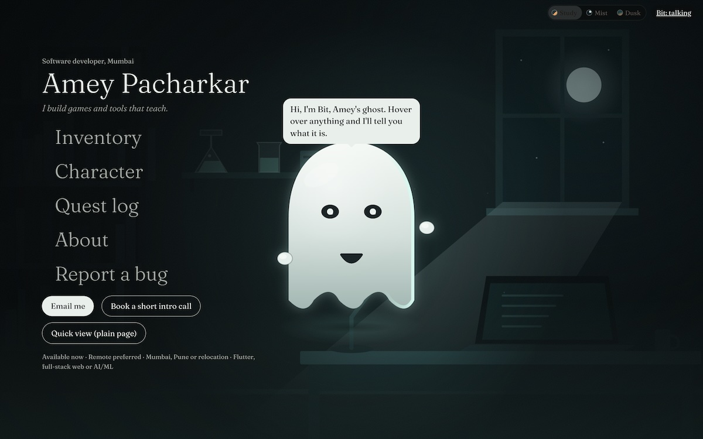

<h1 align="center">Hi, I'm Amey 👋</h1>

  <b>Software developer in Mumbai</b> 
  I build games and tools that teach.

  
  
  
  

  

  My portfolio is a small game menu with a ghost guide named Bit. There's a plain version too, if you're in a hurry.

  🟢 <b>Available now</b> · Remote preferred · Mumbai, Pune or relocation 
  Flutter · Full-stack web · AI/ML

---

## 👋 About

B.E. in Computer Engineering, University of Mumbai (2026). I work with Flutter and Dart, web (React, Next.js, TypeScript) and Python. At CRoad Solutions I build and maintain Flutter and Android apps. I also teach chemistry to CET and JEE students.

## 💼 Work

| | What I did |
| :-- | :-- |
| 📱 **Shivsetu** | Enterprise mobile app live on the Google Play Store, with **100,377 user accounts provisioned** across a 7-tier organizational hierarchy and a phased rollout underway region by region. I engineered the RBAC system and fixed a critical infinite API loop that was firing 80+ unauthorized requests every 3 minutes. *(Private repo. Happy to walk through the architecture.)* |
| 🎓 **JKB Education** | Built and maintain an internal AI-powered career counselling tool, used every admission season for 2 years. |

## 🚀 Selected work

| Project | What it is | Built with | Status |
| :-- | :-- | :-- | :-- |
| **[GhostFS](https://github.com/AmeyPacharkar1896/ghost-fs)** | Ephemeral encrypted file transfer that hides data in video frames | `WebCrypto` `Canvas API` `Elixir` | 🟢 [Live demo](https://ghost-fs.vercel.app) (relay sleeps when idle) |
| **[Chem Arcade](https://ameypacharkar.com/inventory/chem-arcade)** | Browser chemistry games for CET, JEE and board-exam students | `Vercel` `Firebase` | 🟢 Live |
| **[WatchDog](https://ameypacharkar.com/inventory/watchdog)** | Website change monitoring that emails you a diff when a page changes | `SQLite` | 🟠 Demo offline, code private |
| **[Multi-agent games](https://github.com/AmeyPacharkar1896/multi-agent-experiment)** | LLM agents playing social games (Werewolf, Spyfall) locally | `Python` `Ollama` | 🔵 Open source |
| **[Pythia](https://github.com/AmeyPacharkar1896/pythia)** | An AI agent that watches your filesystem and writes and refactors code as you work | `Gemini 2.5` `ChromaDB` `Watchdog` | 🔵 Open source |
| **[GitGuard](https://github.com/AmeyPacharkar1896/git-guard)** | A security bot that scans commits in real time for vulnerabilities and automatically opens issues | `FastAPI` `Webhooks` `PyGitHub` | 🔵 Open source |
| **[Reddit Persona Generator](https://github.com/AmeyPacharkar1896/reddit-persona-generator)** | An ELT pipeline that turns messy social signals into clean, structured user profiles | `Gemini 2.5` `Pydantic` `ELT` | 🔵 Open source |

## 🛠️ Stack

`Flutter` `Dart` `React` `Next.js` `TypeScript` `Python` `Node.js` `PostgreSQL` `SQLite`

---

  <a href="mailto:ameypacharkar076@gmail.com">Email</a> ·
  <a href="https://www.linkedin.com/in/ameypacharkar/">LinkedIn</a> ·
  <a href="https://ameypacharkar.com">Portfolio</a>

